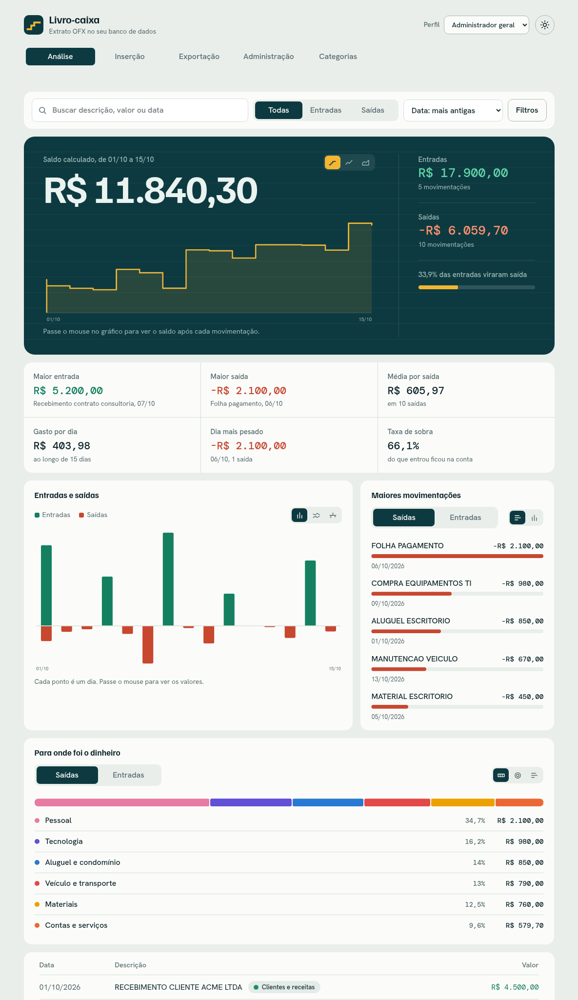
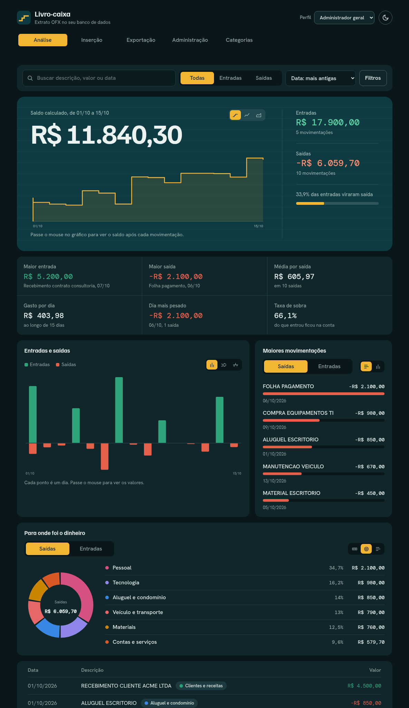
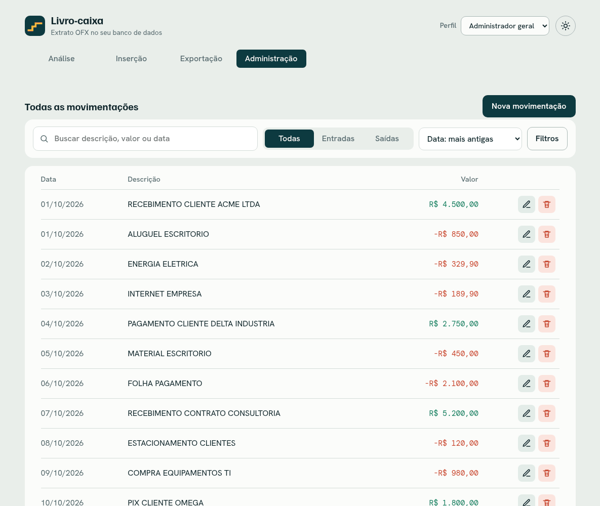
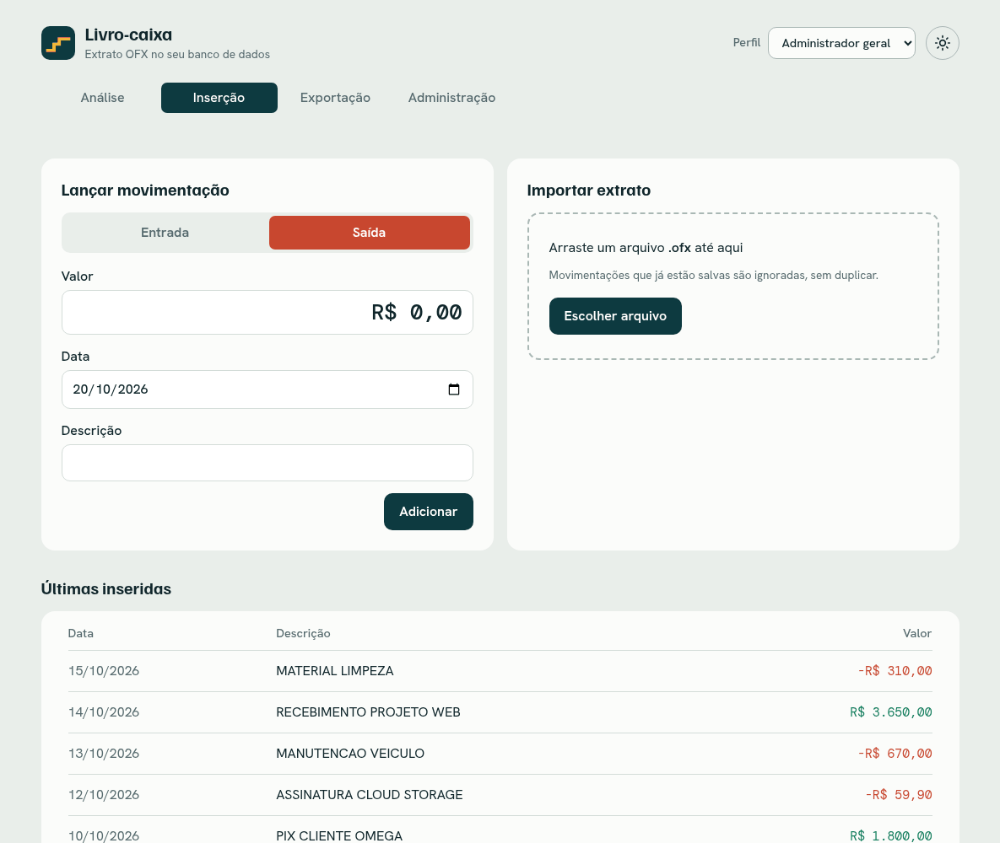
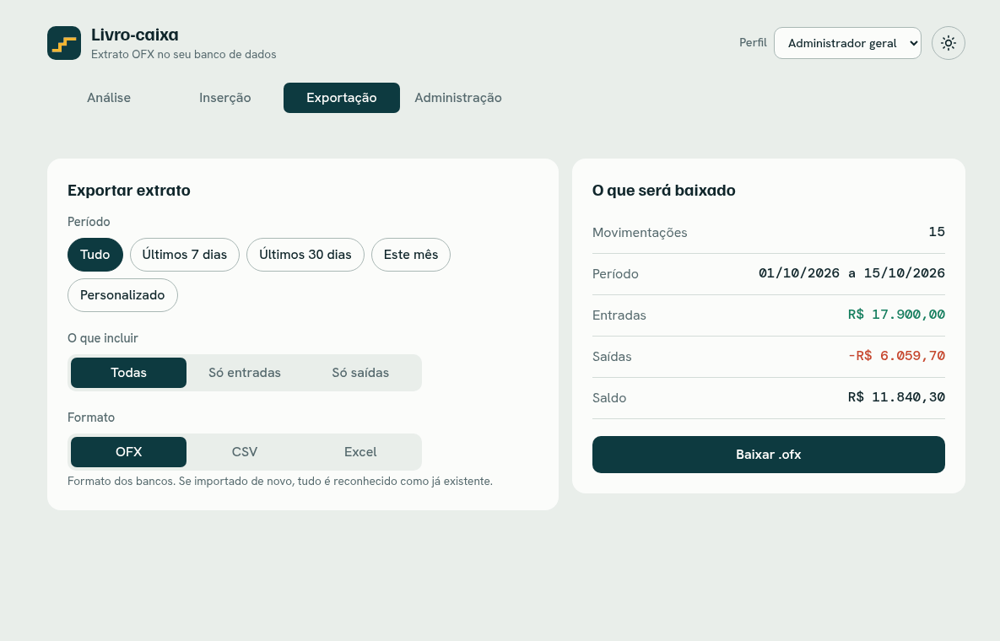
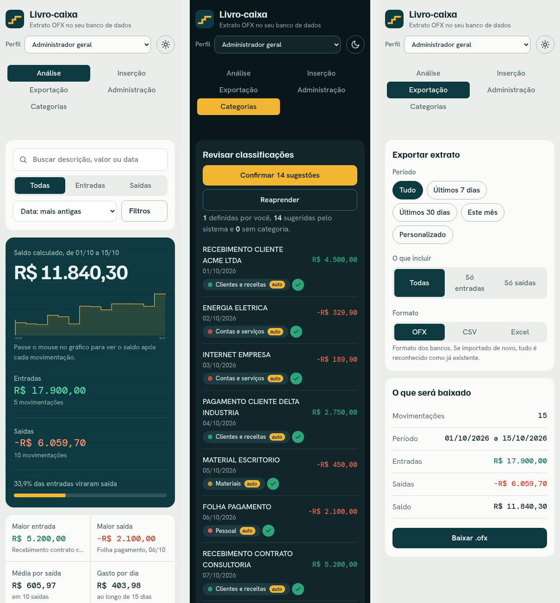
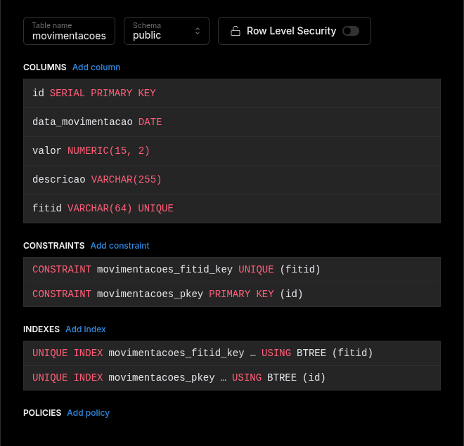
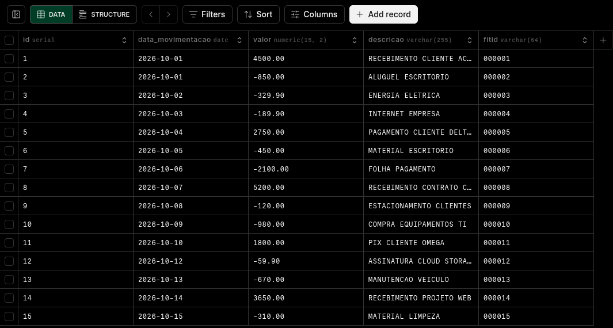

# Livro-caixa — leitura de extratos OFX com Python

Atividade de leitura de arquivos **OFX** (Open Financial Exchange) com Python, levada até o fim: o extrato é lido, calculado, gravado em um banco **PostgreSQL (Neon)** e visualizado numa interface **React** com análise, importação, exportação e administração.



## O que tem aqui

| Parte | Arquivo | O que faz |
|---|---|---|
| Atividade básica | `main.py` | Lê `extrato.ofx` e mostra data, valor e descrição de cada movimentação, a quantidade total, as entradas, as saídas e o saldo |
| Desafio extra | `db.py` | Grava as movimentações no PostgreSQL sem duplicar (coluna `fitid` única + `ON CONFLICT DO NOTHING`) |
| API | `api.py` | Servidor HTTP mínimo (só biblioteca padrão) que a interface usa |
| Excel | `planilha.py` | Gera a planilha `.xlsx` formatada com as cores do projeto |
| Interface | `web/` | React + Vite |

## Interface

Quatro módulos, escolhidos pelo seletor de perfil no topo (o botão de sol/lua alterna entre tema claro e escuro; o padrão segue o sistema).

| Módulo | O que faz | Perfis que veem |
|---|---|---|
| **Análise** | busca e filtros avançados que governam saldo, gráficos, 6 indicadores e a lista (somente leitura) | Administrador geral, Análise |
| **Inserção** | lançar uma movimentação ou importar um `.ofx` | Administrador geral, Inserção |
| **Exportação** | baixar em `.ofx`, `.csv` ou Excel formatado (`.xlsx`), com período e tipo | Administrador geral, Exportação |
| **Administração** | criar, editar e excluir | Administrador geral |

> Os perfis só organizam a tela. **Não há login nem controle de acesso de verdade**: qualquer pessoa que abra a página pode trocar de perfil, e a API aceita qualquer pedido. Por isso o projeto serve para estudo e uso local, não para ficar exposto na internet.

<table>
  <tr>
    <td></td>
    <td></td>
  </tr>
  <tr>
    <td align="center">Análise no tema escuro</td>
    <td align="center">Administração (criar, editar, excluir)</td>
  </tr>
  <tr>
    <td></td>
    <td></td>
  </tr>
  <tr>
    <td align="center">Inserção (lançamento manual e importação de .ofx)</td>
    <td align="center">Exportação (período, tipo e formato)</td>
  </tr>
</table>

Funciona no celular, sem rolagem horizontal:



### Destaques

- **Busca aprofundada:** ignora acento e maiúsculas e procura em descrição, valor e data. Várias palavras (todas precisam aparecer), `-palavra` exclui, `"aspas"` para uma frase. A tecla `/` foca o campo.
- **Filtros:** tipo, período (atalhos ou datas), faixa de valor e ordenação, com chips removíveis.
- **Exportação:** OFX (pode ser reimportado sem duplicar), CSV em português e Excel com totais em fórmulas.
- **Carregamento:** esqueleto com o mesmo formato da página e aviso quando o banco serverless está acordando.
- **Movimento:** entrada em sequência, números que contam, gráficos que crescem e troca de tema em círculo, respeitando "reduzir movimento" do sistema.

## Como rodar

Requisitos: Python 3.10+, Node 20.19+ (ou 22.12+) e um banco PostgreSQL (o projeto usa o [Neon](https://neon.tech)).

```bash
# 1. Ambiente Python
python -m venv venv
source venv/bin/activate          # Windows: venv\Scripts\activate
pip install -r requirements.txt

# 2. Banco: copie o exemplo e coloque a sua connection string
cp .env.example .env              # edite DATABASE_URL

# 3. Atividade básica (não precisa de banco)
python main.py

# 4. Desafio extra: grava o extrato.ofx no banco
python db.py

# 5. Interface (dois terminais)
python api.py                              # API em http://localhost:8000
cd web && npm install && npm run dev       # abra http://localhost:5173
```

## Desafio extra: PostgreSQL

A tabela `movimentacoes` é criada automaticamente. Além das colunas do enunciado, tem `fitid` (o identificador único de cada transação no OFX) com `UNIQUE`: com `ON CONFLICT DO NOTHING`, rodar `db.py` ou importar o mesmo arquivo de novo não duplica registros.

| Estrutura | Dados gravados |
|---|---|
|  |  |

## API

| Método e rota | Função |
|---|---|
| `GET /api/movimentacoes` | lista as movimentações |
| `POST /api/movimentacoes` | cria uma (`data`, `valor`, `descricao`) |
| `PUT /api/movimentacoes/<id>` | edita |
| `DELETE /api/movimentacoes/<id>` | exclui |
| `POST /api/importar` | recebe um `.ofx` no corpo e grava sem duplicar |
| `GET /api/exportar?de=&ate=&tipo=&formato=` | baixa `.ofx` ou `.xlsx` filtrado (`tipo`: todas, entradas, saidas) |

## Estrutura

```
.
├── main.py            atividade básica
├── db.py              PostgreSQL (pool de conexões, importação sem duplicar)
├── api.py             API HTTP
├── planilha.py        exportação para Excel
├── extrato.ofx        extrato de exemplo
├── requirements.txt
├── .env.example       modelo do .env (o .env real fica fora do git)
├── docs/              imagens deste README
└── web/               React + Vite
    └── src/
        ├── modulos/       Análise, Inserção, Exportação, Administração
        ├── componentes/   tabela, filtros, gráficos, formulário, esqueleto
        ├── hooks/         dados, filtros, visibilidade
        └── styles.css     identidade visual e temas claro/escuro
```

## Segurança

- A senha do banco fica só no `.env`, que está no `.gitignore` e nunca foi commitado.
- Todas as consultas SQL usam parâmetros (sem concatenar texto do usuário).
- A API escuta apenas em `localhost`.
- O `extrato.ofx` do repositório é um arquivo de exemplo, com dados fictícios.
