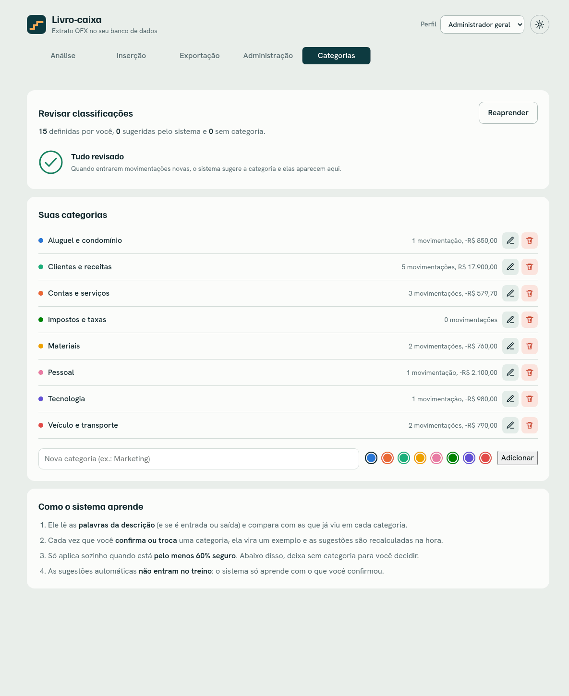

# Livro-caixa — leitura de extratos OFX

Sistema para trabalhar com extratos **OFX** (Open Financial Exchange): o extrato é importado, gravado em um banco **PostgreSQL** por uma **API Node.js (Express)** com login e perfis, e visualizado numa interface **React** com análise, importação, exportação, administração e categorias que aprendem.


## O que tem aqui

| Parte | Onde | O que faz |
|---|---|---|
| API | `backend/` | Node.js + Express em módulos (auth, movimentações, categorias, importação, exportação): login JWT, perfis, validação, importação sem duplicar (`fitid` único + `ON CONFLICT DO NOTHING`), Excel formatado e classificador de categorias que **aprende** (Naive Bayes, sem bibliotecas) |
| Banco | `backend/scripts/seed.js` | `npm run db:seed` cria as tabelas, as categorias padrão e os usuários, sem nenhuma movimentação |
| Interface | `web/` | React + Vite, com tela de login |
| Testes da API | `backend/insomnia/` | coleção do Insomnia (login e movimentações) |

## Interface

Depois do login, aparecem os módulos do perfil de quem entrou (o nome e o botão **Sair** ficam no topo; o botão de sol/lua alterna entre tema claro e escuro, e o padrão segue o sistema).

| Módulo | O que faz | Perfis que veem |
|---|---|---|
| **Análise** | busca e filtros avançados (inclusive por categoria) que governam saldo, gráficos, 6 indicadores, divisão por categoria e a lista (somente leitura) | Administrador geral, Análise |
| **Inserção** | lançar uma movimentação ou importar um `.ofx` | Administrador geral, Inserção |
| **Exportação** | baixar em `.ofx`, `.csv` ou Excel formatado (`.xlsx`), com período e tipo | Administrador geral, Exportação |
| **Administração** | criar, editar e excluir; trocar a categoria com um clique | Administrador geral |
| **Categorias** | revisar o que o sistema classificou, confirmar com um clique (ou todas de uma vez), criar/editar categorias | Administrador geral, Inserção |

> O acesso é por **login**: o perfil do usuário define as abas que aparecem **e** o que a API aceita (um perfil sem permissão recebe `403` mesmo chamando a API direto). Detalhes em [Segurança](#segurança).

<table>
  <tr>
    <td></td>
    <td></td>
  </tr>
  <tr>
    <td align="center">Análise no tema escuro</td>
    <td align="center">Administração (criar, editar, excluir)</td>
  </tr>
  <tr>
    <td></td>
    <td></td>
  </tr>
  <tr>
    <td align="center">Inserção (lançamento manual e importação de .ofx)</td>
    <td align="center">Exportação (período, tipo e formato)</td>
  </tr>
</table>

Funciona no celular, sem rolagem horizontal:


### Categorias que aprendem



- **Já nasce funcionando:** o seed cria 8 categorias padrão (clientes e receitas, aluguel, contas e serviços, pessoal, materiais, tecnologia, veículo, impostos) com palavras iniciais, e tudo o que for importado ou lançado é classificado.
- **Classificação automática:** toda movimentação nova (importada ou lançada) recebe uma sugestão marcada como **auto**, com um ✓ para confirmar com um clique.
- **Aprende com você:** cada categoria que você confirma ou troca vira um exemplo de treino (peso 3x) e as outras sugestões são recalculadas na hora. Exemplo real do projeto: "ALUGUEL ESCRITORIO" é ambíguo (47% de certeza, então o sistema não aplica sozinho); depois de você ensinar uma vez, "ALUGUEL SALA 2" já entra como Aluguel com 91%.
- **Só aplica quando está seguro:** abaixo de 60% de confiança a movimentação fica sem categoria para você decidir. As sugestões automáticas **não entram no treino**, então o sistema não reforça os próprios erros.
- **Fácil de usar:** clique no chip de categoria de qualquer linha para buscar, trocar, remover ou **criar uma categoria na hora**; o módulo Categorias reúne tudo que precisa de revisão e tem "Confirmar todas as sugestões" e "Reaprender".
- **Aprovação com movimento:** o ✓ "estala" com um anel e o traço se desenha; ao aprovar em massa, as linhas piscam em verde e recolhem em cascata, e a fila vazia mostra um ✓ que se desenha.
- **Aparece nas análises:** filtro por categoria, gráfico "Para onde foi o dinheiro" e coluna Categoria na exportação para Excel e CSV.

### Destaques

- **Busca aprofundada:** ignora acento e maiúsculas e procura em descrição, valor e data. Várias palavras (todas precisam aparecer), `-palavra` exclui, `"aspas"` para uma frase. A tecla `/` foca o campo.
- **Filtros:** tipo, período (atalhos ou datas), faixa de valor e ordenação, com chips removíveis.
- **Exportação:** OFX (pode ser reimportado sem duplicar), CSV em português e Excel com totais em fórmulas.
- **Gráficos com estilo à escolha:** cada gráfico tem botões de ícone no canto para trocar o tipo (saldo: degraus, linha ou área; entradas/saídas: colunas, linhas ou saldo do período; ranking: barras ou colunas; categorias: barra empilhada, rosca ou barras). A escolha fica salva no navegador.
- **Carregamento:** esqueleto com o mesmo formato da página e aviso quando o banco serverless está acordando.
- **Movimento:** entrada em sequência, números que contam, gráficos que crescem e troca de tema em círculo, respeitando "reduzir movimento" do sistema.

## Como rodar

Requisitos: Node 20.19+ (ou 22.12+) e um banco PostgreSQL (o [Neon](https://neon.tech) ou um Postgres local, inclusive por socket Unix, ex.: `postgresql:///meubanco`).

```bash
# 1. Configuração: copie o exemplo e preencha DATABASE_URL, JWT_SEGREDO e SEED_SENHA
cp .env.example .env

# 2. API: instala e deixa o banco pronto e limpo (tabelas, categorias padrão e 4 usuários, um por perfil)
cd backend && npm install
npm run db:seed          # senha dos usuários = SEED_SENHA do .env
npm run dev              # API em http://localhost:3333

# 3. Interface (outro terminal)
cd web && npm install && npm run dev       # abra http://localhost:5173 e entre com um dos usuários abaixo
```

Usuários criados pelo seed (todos com a senha `SEED_SENHA`): `admin@`, `analise@`, `insercao@` e `exportacao@livrocaixa.com`. Testes sem banco: `cd backend && npm test`.

**Console da API:** cada chamada (GET, POST, PUT, DELETE) aparece com hora, rota, código HTTP e uma descrição do que aconteceu (ou o motivo do erro), por exemplo `PUT /api/movimentacoes/12  200  Movimentação editada [ADMIN]`. Senha, token e corpo da requisição nunca são registrados.

> **Sem o banco configurado**, a API nem sobe e diz o que falta (`DATABASE_URL não definida`). Se o banco cair com a API no ar, a tela mostra "Sem acesso ao banco de dados".

## Testando a API no Insomnia

Importe `backend/insomnia/livro-caixa.insomnia.json` (Insomnia → *Import*). A coleção é básica, com descrição em cada requisição: **Login** e o CRUD de **movimentações** (listar → criar → editar → excluir). O resto do sistema (categorias, importação, exportação, perfis) é mostrado pela interface.

Antes: rode a API e, em *Manage Environments*, troque `senha` pela `SEED_SENHA` do `.env`. Rode o Login uma vez; as outras requisições usam o token dele sozinhas. A aba **Test** confere o código de status de cada uma.

## Banco de dados

As tabelas são criadas pelo `npm run db:seed` (com `IF NOT EXISTS`: rodar de novo não apaga nem duplica nada). A `movimentacoes` tem `fitid`, o identificador único de cada transação no OFX, com `UNIQUE`: importar o mesmo arquivo de novo não duplica registros.

| Estrutura | Dados gravados |
|---|---|
|  |  |

## API

Tudo em `/api`; menos `/auth/login`, `/auth/refresh`, `/auth/logout` e `/saude`, toda rota exige `Authorization: Bearer <token>`.

| Método e rota | Função | Perfis |
|---|---|---|
| `POST /auth/login` · `/auth/refresh` · `/auth/logout` | entrar, renovar o token, sair | público |
| `GET /auth/eu` · `POST /auth/trocar-senha` | quem sou eu · trocar a senha | logado |
| `GET /movimentacoes` | lista (com categoria, se foi automática e a confiança) | todos |
| `POST /movimentacoes` | cria (`data`, `valor`, `descricao`, `categoria_id`?) | admin, inserção |
| `PUT` · `DELETE /movimentacoes/:id` | edita · exclui | admin |
| `PUT /movimentacoes/:id/categoria` | escolhe ou confirma a categoria (o sistema aprende) | admin, inserção |
| `GET /categorias` | lista | todos |
| `POST /categorias` · `PUT` · `DELETE /categorias/:id` · `POST /categorias/reclassificar` | cria, edita, exclui, refaz o treino | admin, inserção |
| `POST /importacao` | recebe um `.ofx` (multipart, campo `arquivo`) e grava sem duplicar | admin, inserção |
| `GET /exportacao?de=&ate=&tipo=&formato=` | baixa `.ofx` ou `.xlsx` filtrado (`tipo`: todas, entradas, saidas) | admin, exportação |

## Estrutura

```
.
├── extrato.ofx                extrato de exemplo
├── .env.example               modelo do .env (o .env real fica fora do git)
├── backend/                   API Node.js
│   ├── insomnia/              coleção do Insomnia (login e movimentações)
│   ├── scripts/               seed.js (tabelas, categorias e usuários)
│   ├── test/                  testes sem banco
│   └── src/
│       ├── app.js, server.js
│       ├── config/            env.js, permissoes.js (perfil -> permissões)
│       ├── compartilhado/     db, erros, schemas e middlewares (autenticar, autorizar, validar, registrar, tratarErros)
│       └── modulos/           um por assunto, cada um com rotas -> controlador -> serviço
│           ├── auth/  movimentacoes/  categorias/ (+ classificador.js)
│           └── importacao/ (+ ofx.parser.js)  exportacao/ (+ formatos.js)
├── docs/                      imagens deste README
└── web/                       React + Vite (a "view"; ícone da aba em public/favicon.svg)
    └── src/
        ├── modulos/       Login, Análise, Inserção, Exportação, Administração, Categorias
        ├── componentes/   tabela, filtros, gráficos, formulário, esqueleto
        ├── hooks/         dados, filtros, visibilidade
        └── styles.css     identidade visual e temas claro/escuro
```

## Segurança

- **Login com JWT:** o token de acesso dura 15 minutos; o de renovação (7 dias) é trocado a cada uso e, se um já usado reaparecer, todas as sessões da pessoa são derrubadas. Senhas com bcrypt; no banco só o hash do token de renovação.
- **Perfis no servidor:** cada rota exige uma permissão (`config/permissoes.js`); sem ela, `403`. Usuário desativado perde o acesso na hora.
- **Entrada validada** com zod (datas reais, valores finitos, limites de tamanho); corpo JSON limitado a 100 kb e upload a 5 MB, só em memória.
- **Todas as consultas SQL usam parâmetros** (sem concatenar texto do usuário).
- **Proteções HTTP:** helmet, CORS só para o front-end configurado, limite de requisições por IP (e de tentativas de login), mensagens de erro que não vazam detalhes internos e a API escuta só em `localhost`.
- **Segredos** (banco, `JWT_SEGREDO`, senha do seed) ficam só no `.env`, fora do git. O seed não roda em produção e não tem senha padrão.
- Os tokens ficam no `localStorage` do navegador, como na referência do projeto. Para produção, o ideal é cookie `HttpOnly` + HTTPS.
- O `extrato.ofx` do repositório é um arquivo de exemplo, com dados fictícios.
