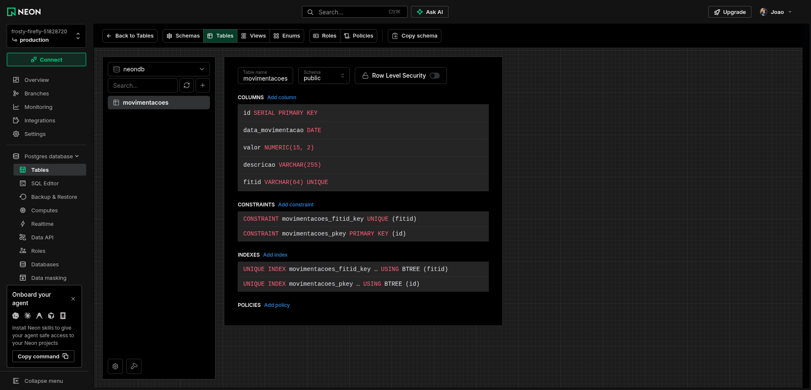
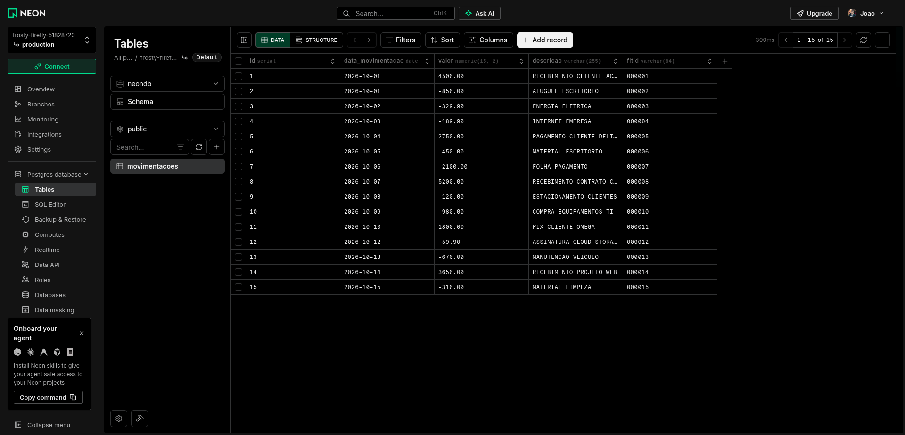

# Leitura de Arquivos OFX com Python

Lê um extrato bancário `.ofx`, exibe as movimentações com os totais e (desafio extra) grava tudo em um PostgreSQL no Neon.

## Como rodar

```bash
python -m venv venv
source venv/bin/activate
pip install -r requirements.txt

python main.py   # exibe o extrato, entradas, saídas e saldo
python db.py     # grava no PostgreSQL (precisa do .env)
```

### Interface web (React)

```bash
python api.py                         # terminal 1: API em localhost:8000
cd web && npm install && npm run dev  # terminal 2: abra http://localhost:5173
```

A interface tem quatro módulos, escolhidos pelo seletor de perfil no topo:

| Módulo | O que faz | Perfis que veem |
|---|---|---|
| Análise | busca e filtros avançados que governam saldo, gráfico, indicadores e lista (somente leitura) | Administrador geral, Análise |
| Inserção | lançar movimentação e importar `.ofx` | Administrador geral, Inserção |
| Exportação | baixar em `.ofx`, `.csv` ou Excel formatado (`.xlsx`), com período (atalhos ou datas personalizadas) e tipo (todas, só entradas, só saídas) | Administrador geral, Exportação |
| Administração | criar, editar e excluir | Administrador geral |

Os perfis só organizam a tela: não há login nem controle de acesso de verdade.

Mostra o saldo, o gráfico do saldo acumulado, entradas, saídas e as movimentações salvas no Neon. O botão "Importar arquivo .ofx" (ou arrastar o arquivo) grava no banco sem duplicar. Também dá para criar, editar e excluir movimentações (CRUD completo) e exportar o que está no banco de volta para um `.ofx`.

Para o `db.py` e a API, copie `.env.example` para `.env` e preencha `DATABASE_URL` com a connection string do Neon.

## Desafio extra: PostgreSQL

Tabela `movimentacoes` criada no Neon. Além das colunas do enunciado, tem `fitid` (identificador único da transação no OFX) com `UNIQUE`. Com `ON CONFLICT DO NOTHING`, rodar o `db.py` de novo não duplica registros.



Registros gravados (15 movimentações do `extrato.ofx`):


